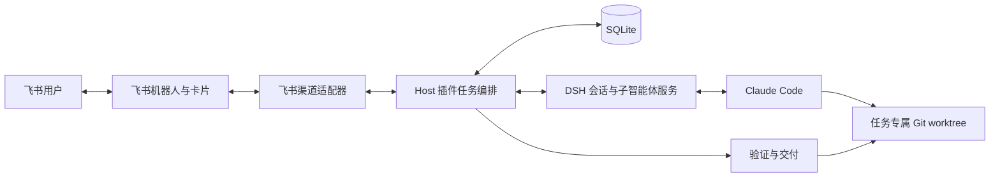

# DeepSeek Harness 飞书需求开发 Agent 插件设计

## 目标与首版范围

用户在飞书单聊中提交需求。项目可识别且需求正文去掉链接后仍有内容时，插件自动完成内部方案设计、开发和验证；信息不足时才通过卡片补充。用户仍可处理单次工具授权、取消任务、要求返工和确认验收。DeepSeek Harness（DSH）负责托管会话和 Claude Code 子智能体，插件负责跨轮任务状态与飞书交互。

首版面向一个飞书企业自建应用机器人、一个仓库、一位操作人和一个并发开发任务。用户将 TAPD 需求正文粘贴或转发给机器人，可附需求 ID 和链接。只发链接时，机器人通过卡片收集正文。若后续需要由插件主动询问另一个 TAPD 机器人，先验证该机器人的回复可由本应用读取，再增加需求来源适配器。

交付以本地分支和验证结果为基础。仓库已配置远端并获准推送时，可以提交草稿 PR。合并、部署和 TAPD 状态回写由后续需求决定。

## 用户流程

用户发送 `开发需求｜订单服务`，附上需求正文与 TAPD 链接。插件根据项目名称匹配已配置的仓库。项目可识别且正文有效时立即排队设计，随后自动进入开发；项目或正文不明确时，通过同一张卡片补全，补齐后同样自动执行。

| 卡片 | 展示内容 | 操作 |
| --- | --- | --- |
| 待补充需求 | 需求摘要、来源链接、仓库、待补充条件 | **补充信息**、**取消** |
| 任务进度 | 当前阶段、实现方案、影响范围与验证计划 | **取消** |
| 单次授权 | 请求来源、操作、目标、原因、有效期 | **仅允许本次**、**拒绝** |
| 阻塞 | 失败阶段、失败原因及可查看的验证摘要 | **重试**、**提交补充**、**取消**，按阶段显示可用操作 |
| 开发交付 | 分支和提交、可用的草稿 PR 链接、改动摘要、实际验证结果 | **查看改动**、**要求返工**、**调整范围并重新设计**、**确认验收** |

补充和返工说明使用飞书卡片表单提交。用户也可以回复原任务卡片，或在普通消息中带任务编号补充信息。多个任务同时存在且消息未指明目标时，机器人请用户选择任务。补充需求或调整范围后，插件自动生成下一版方案并继续开发，不设置人工审批闸门。

## 插件架构

插件以可安装的 DSH Host bundle 交付。`package.json` 声明 `dsh.bundle.patch`，`cordis.patch.yml` 注册 Host 插件入口。入口通过 `apply(ctx, config)` 启动飞书连接与队列处理，插件卸载时关闭连接、停止领新任务并清理它拥有的运行。首版管理入口使用 DSH 插件配置，业务交互使用飞书。

| 模块 | 职责 |
| --- | --- |
| 飞书渠道适配器 | 收取单聊消息与卡片回调，发送和更新互动卡片。已有 DSH 飞书渠道具备这些插件接口时复用，否则接入飞书 Channel SDK。 |
| 任务编排 | 校验用户、管理阶段、控制并发、调度重试。插件把每次变更和待发送通知一起入库。 |
| Harness 运行适配器 | 管理每条任务的主会话，使用 `ctx.subagents.startActivation()` 委派 Claude Code，等待执行结果并关联运行 ID。 |
| 仓库与验证 | 解析配置中的仓库映射，创建任务独立 worktree，读取实际 diff 和提交信息，执行已配置的验证命令。 |
| 持久化 | SQLite 保存任务、需求版本、方案版本、委派尝试、飞书消息映射和待发送通知。DSH 会话日志保存相应的 Agent 活动。 |

### Claude Code 委派

1. **设计**。提供当前需求版本、项目路径、仓库约定与需求正文。设计阶段按适配器可验证的能力配置为只读。要求输出改动范围、方案、风险、待澄清事项与验证计划。插件校验结果的必填字段，校验通过后自动登记开发队列。
2. **开发**。先持久化任务分支、基线提交与 worktree 路径，再创建或恢复任务 worktree，确保准备阶段中断后仍能按原意图续跑。向 Claude Code 提供当前需求、方案、基线提交与检查命令。委派必须返回 `implemented`、`no_change`、`needs_clarification` 或 `blocked` 及摘要；信息不足或需要改变范围时进入阻塞并等待补充，不能直接交付或自动扩大范围。涉及实际操作时，开发 Agent 可在提交后执行验证步骤并留下绑定当前提交的命令工具证据；Host 随后读取实际仓库状态和验证结果，返工必须相对上一轮交付产生新提交，再填充交付卡。
3. **返工**。使用原 worktree 与已提交的返工意见发起新委派。用户选择调整范围时生成新版方案并自动继续开发；Agent 发现需要额外信息或扩大范围时进入阻塞，由用户补充后重新设计。

### 分层验证与证据复用

验证方案由需求行为决定，而不是由任务大小或 `fix` 类型决定。界面、浏览器、Desktop 和明确用户操作使用 `operation`；纯代码结构、接口和命令行逻辑使用固定项目检查。缺陷修复仍要求基线复现与修复后回归，但不要求为了修复而执行无关的 GUI 操作。

操作证据按以下优先级产生：

1. 维护者配置的项目操作检查在待交付提交上输出可信报告。
2. 没有项目报告时，Host 复核开发阶段已经采集的证据。只有提交、操作、预期、顺序步骤及所需基线全部匹配，才复用并跳过独立验证 Agent。
3. 开发证据缺失、过期或不完整时，独立验证 Agent 只补当前缺少的运行验证。项目检查失败或变更仍待审批时，不启动操作验证。

证据在推送前持久化，因此推送重试不重复实测。缺陷返工可复用同一基线已有的实测复现记录，但仍须验证新提交。助手正文、退出码和编译日志不能替代逐项工具观察；复用不会绕过提交绑定、变更审核、固定检查或推送门禁。

独立 Agent 验证之前，Host 先执行固定环境预检。存在 `package-lock.json` 时由 Host 运行 `npm ci --no-audit --no-fund`，允许锁文件声明的必要生命周期脚本，在当前隔离工作树的 `node_modules` 内记录锁文件与 manifest 指纹；缓存命中前执行固定 `npm ls --depth=0` 完整性检查，指纹变化、依赖损坏或上次安装失败时重新执行。模型不再负责可确定的 npm 依赖安装。

每条有效观察在委派运行期间即时写入任务检查点，绑定提交、需求版本、方案版本、完整步骤和基线。开发阶段的不完整证据与独立验证检查点使用同一身份条件，只补缺失步骤；完整证据也必须通过逐步观察和基线校验后才能复用。失败或重启后立即回填已完成进度，只把已完成编号交给下一次委派，Agent 为恢复页面状态可做必要导航；临时数据或运行状态丢失时先幂等重建前置状态，不重复输出已完成证据。Host 最终合并检查点和本轮记录并重新校验全部步骤；任一身份字段不匹配都从当前提交重新验证。独立委派有 10 分钟总时限、60 秒父会话/activation 启动时限、3 分钟无协议进展时限和 3 分钟单步时限，整个验证阶段有 15 分钟总预算，资源清理最多等待 10 秒；首步计时从 activation 就绪后开始，只有 Host 接受下一步骤证据才重置单步计时。Provider、模型和宿主环境故障由 Host 或操作人处理，验证 Agent 只执行交付必检步骤，不自行修复环境或扩大巡检范围，全量回归由项目固定检查承担。卡片和调度面板展示环境预检、基线、当前步骤、本步耗时、推送状态和验证模型输出；阻塞后冻结本步耗时，避免验证过程成为黑盒。

明确 Desktop 的需求由 Host 管理隔离验证环境。专用只读模板包含测试 Provider、插件配置、样例数据版本及样例 Git 仓库声明；Host 校验模板指纹，固定探测样例仓库 HEAD 和 origin，再复制为每任务独立 profile。不同任务不共享运行实例，同任务续跑复用副本，模板变化或健康检查失败时重建。Host 使用配置的 DSH 可执行文件和隔离 profile 参数启动进程，并重复执行维护者配置的固定健康检查，确认实际隔离实例、Provider 和样例库就绪后才允许 activation 开始。健康检查或模板未配置时在委派前阻塞。Agent 只接收已就绪实例，结束后 Host 停止进程树但保留同任务副本，插件卸载清理活动实例。模板不能来自用户正在使用的真实 profile，凭据只能使用专用测试凭据引用。

当前 DSH `0.2.2-rc.5` 的服务接口支持创建或恢复主 Agent、启动子智能体和等待委派结果。Claude Code 外部子智能体每次只处理一次委派，续轮所需上下文由插件显式传入。开发前需验证当前 Desktop 配置中的 Claude Code provider 可由插件调用，以及工作目录和权限策略在实际后端生效。[DSH Agent 接口](<E:/DeepSeek Harness/resources/app.asar/dsh/node_modules/@deepseek-ai/dsh-agent/README.md:28>) · [DSH 子智能体接口](<E:/DeepSeek Harness/resources/app.asar/dsh/node_modules/@deepseek-ai/dsh-subagent/README.md:59>)

调度页左侧列出任务。选中后，右侧按阶段显示模型正文、最终设计方案、开发摘要和验证结果。标题和四个标签位于内容滚动区上方，长任务滚动到底部后仍可直接切换标签。Claude Code 和 Codex Provider 运行时，插件从对应的 DSH 托管子进程读取助手正文事件，跟随实际选用的模型。没有可读取正文事件的 Provider 仍在委派结束后显示最终结果。调度页约每 1.5 秒刷新选中的运行任务，每个任务保留最近 8 次有输出的调用，每次保留最后约 24,000 字符。正文仅供面板用户观察，不参与结果校验，不进入飞书卡片。调用详情可展开查看委派 ID、开始时间和插件心跳。运行中的飞书卡片每 15 秒刷新心跳，且保留当前操作版本。

## 状态、授权与恢复

主流程为 `设计中 → 已入队 → 开发中 → 验证中 → 待验收 → 已验收`。仅信息不足时进入 **待补充需求**，补齐后自动进入设计。阶段异常进入 **阻塞** 并保留失败位置。**取消**结束任务，运行中的委派通过插件持有的执行句柄取消。工具单次授权另存为当前运行的待决请求，答复后回到原执行阶段。

- **自动流转**以任务当前需求版本和方案版本为输入，每次设计完成只登记一条开发队列记录。卡片操作仍绑定任务、消息和当前 revision，重复事件通过事件表去重。
- **工具授权**绑定来源、任务、运行尝试、具体工具调用及有效期。DSH 原生请求通过任务会话范围内的 `approval/request` 答复。Claude Code 后端的权限回传单独联调。若适配器无法提供可答复的原请求，Claude Code 只执行能够验证权限边界的开发操作，需要额外授权的操作在 DSH 主会话中发起。被拒绝的请求对应的操作由其原权限系统处理。
- **飞书身份**以应用和用户标识校验操作者，并核对会话、任务、卡片动作及当前版本。未通过校验、已消费或过期的动作只返回状态提示。回调先保存决策，再异步执行耗时步骤。
- **重启恢复**从数据库恢复待补充、已入队和待验收状态。旧版待确认、待审批和暂缓任务按已有需求与方案自动迁移到设计或开发队列。对中断的开发，先核对对应 worktree 和该次运行状态，再决定是否继续或发出阻塞卡。进程内的单次授权请求随原运行失效。失败的通知从待发送记录重试。

参考：[DSH 原生授权接口](<E:/DeepSeek Harness/resources/app.asar/dsh/node_modules/@deepseek-ai/dsh-user-approval/README.md:28>) · [飞书 Channel SDK](https://open.feishu.cn/document/mcp_open_tools/integrating-agents-with-feishu/integrate-feishu-channel.md)

## 配置与运行

| 配置项 | 首版用途 |
| --- | --- |
| 飞书应用及允许用户 | 配置 App ID 和允许发起、操作任务的用户标识。App Secret 存入 DSH 凭据服务。 |
| 模型配置 | 面板只填写 Anthropic 兼容 Base URL、模型名称和 API Key；自动使用设计 Provider 现有的 profile、权限和进程配置，所有模型映射及 Provider 模型名称统一更新，其他 `settings.json`、Provider 和委派字段保持不变。API Key 只写不回显。 |
| 项目映射 | 项目名或别名对应本地仓库、基线分支、验证命令和允许的交付方式。 |
| 开发并发 | 默认 `1`。完整需求自动排队，运行中的开发占用一个名额。 |
| 授权有效期 | 到期后失效，操作仍需要时由运行端发起新的请求。 |

插件随 DSH Host 运行。首版用飞书长连接接收事件，本机需要能访问飞书服务。DSH 关闭期间任务保存在本地，重新启动后恢复处理已入库的任务与通知。配置数据使用 DSH 的配置和凭据接口保存。[DSH Host bundle](<E:/DeepSeek Harness/resources/app.asar/dsh/node_modules/@deepseek-ai/dsh-agent-preset/skills/dsh-doc/references/host-plugin.md:3>) · [DSH 配置与凭据](<E:/DeepSeek Harness/resources/app.asar/dsh/node_modules/@deepseek-ai/dsh-agent-preset/skills/dsh-doc/references/configuration.md:1>)

## 实施顺序与验收

1. **验证集成**。在当前 Desktop 配置中完成一次 Claude Code 委派、一次飞书表单回调和一次 DSH 单次授权。记录 Claude Code 原生权限回传是否可用，确认首版支持的授权范围。
2. **上线单仓库闭环**。用完整真实需求从单聊创建任务，不点击确认或审批即可看到自动设计、独立 worktree 上的开发结果和验证记录；信息不足的任务补齐后自动执行。
3. **验证异常路径**。重复事件只启动一次开发，旧卡片按钮和非操作人点击都不能推进任务。模拟验证失败和需要补充信息的开发结果，检查飞书收到阻塞卡并能提交补充。
4. **验证重启与返工**。设计或开发排队时重启 DSH，仍能自动继续。运行中重启后能看到待核对状态，原工具授权失效。交付后的返工在原 worktree 继续，并生成新的验证结果。
