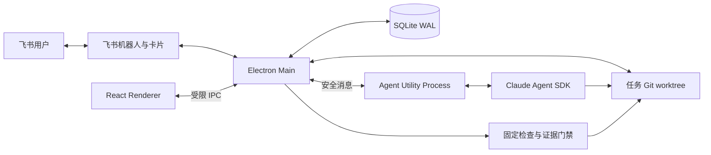

# 飞书需求开发桌面应用设计

## 产品目标

需求交付台是独立桌面产品，不依赖其他 Agent 宿主。用户从飞书提交需求后，应用自动执行设计、开发、验证与交付，仅信息不足、范围替代和高风险变更需要人工介入。桌面面板提供持续可见的任务进度和真实模型输出，不再以黑盒方式等待最终卡片。

应用面向一个飞书企业自建应用、本机多个 Git 仓库和串行开发队列。交付结果包括经验证的远程任务分支，以及同一远程 master 的合并提交。部署和外部工单回写独立于交付流程。

## 总体架构



| 层 | 职责 | 明确不承担 |
| --- | --- | --- |
| Main | 应用生命周期、配置、渠道、任务状态机、SQLite、Git、检查和推送 | 不在 UI 中执行系统命令 |
| Utility Process | 每个 Agent 调用的 SDK 会话、流事件归一化、工具证据提取 | 不读取或写入任务数据库 |
| Preload | 暴露固定的任务与配置接口 | 不暴露通用 IPC、Node 或文件系统 |
| Renderer | 任务队列、输出、方案、证据、交付和设置 | 不接触密钥、环境变量或原始工具记录 |

主进程只向 Utility Process 发送当前调用必需的模型配置。子进程把助手正文、SDK session ID、最终文本和证据摘要发回主进程；工具输出只在子进程内计算 SHA-256 和提取匹配观察行。Agent 进程退出时，主进程让对应调用失败并可重建进程，不拖垮界面。

## 配置与凭据

应用配置保存在 Electron `app.getPath('userData')` 下的 `settings.json`，业务数据默认保存在其 `tasks` 子目录，也可由用户选择其他绝对路径。

公开配置仅包含 App ID、操作人、数据目录、模型地址、模型名称、项目列表以及密钥是否已配置。App Secret 和 API Key 使用 `safeStorage` 加密，读取时仅在主进程解密。表单留空保留原值；操作系统加密不可用或密文无法解密时明确报错，不退回明文保存。

项目检查由可执行文件、固定参数数组和超时组成，不通过 shell 拼接。仓库检查只运行固定 Git 查询。应用启动、保存配置和退出分别拥有明确的渠道、计时器、任务与 Agent 资源清理边界。

## 需求与状态机

完整需求自动进入设计，无方案确认闸门：

```text
待补充（仅信息不足）
  → 等待设计 → 设计中 → 等待开发 → 开发中
  → 等待验证 → 验证中 → 推送任务分支并合入远程 master → 已交付
```

异常保留失败阶段并进入阻塞；补充、返工和范围调整均生成对应版本。每次任务变更以乐观 revision 写入 `tasks` 和 `history`，通知写入 `outbox`，卡片消息映射和事件去重独立持久化。SQL 全部成功后才更新内存 revision，避免唯一键冲突后留下伪状态。

开发前先保存 worktree 意图，再准备目录。重启后恢复排队任务；对中断运行核对 worktree 和提交，旧证据按身份复用，无法安全续跑时明确阻塞。取消通过 AbortSignal 传到 Utility Process，SDK 关闭对应 query 和子进程。

## Agent 调用

三个阶段使用同一独立执行接口：

1. **设计**：在原始项目根目录只读运行，开放 Read、Grep、Glob，使用 plan 权限；返回 summary、scope、risks、verification 和 validation。
2. **开发**：在任务 worktree 运行，根据已确定方案修改、测试并创建非空本地提交；返回 implemented、no_change、needs_clarification、blocked 或 alternative。
3. **验证**：在固定待验提交上只执行交付必检步骤，返回结构化结果和工具观察。

开发、构建和测试需要无人值守执行，因此使用 SDK 的自动权限模式；真正的交付边界由任务 worktree、提示约束、变更审核、证据检查和主程序推送门禁共同承担。设计阶段不开放写入、命令和网络工具。所有阶段禁止部署和读取凭据，范围变化必须审批。

SDK `includePartialMessages` 提供正文增量；只消费顶层 `text_delta`，不展示私有推理或嵌套子任务正文。完整 assistant 消息用于最终结果语义，不与增量重复拼接。`system/init` 或消息中的 `session_id` 持久化为后续调用的 resume 标识。

## Git 与交付门禁

主程序创建任务专属分支和 worktree，开发后读取真实 HEAD、diff 与文件状态。空提交、无增量返工、未授权删除和可疑脚本不会被模型摘要掩盖。项目固定检查按配置顺序执行并保存有界摘要。

通过后，主程序推送已验证的同名分支并持久化推送结果，然后合入同一远程的 `master`。可快进时使用已验证提交。分叉时生成双亲合并提交，在隔离 worktree 对该提交重新执行变更审查、固定检查和所需操作验证。更新目标引用前核对远端基线，更新后读取实际提交关系。任务分支或目标分支更新失败会进入可重试阻塞。合并候选和已验证的任务分支持久化供重试核对，只在确认目标包含交付提交后自动标记“已交付”。历史验收记录保留，升级不会触发历史任务的合并。

## 分层验证与操作证据

验证由需求行为决定，而不是所有变更都重复启动独立 Agent。纯代码、接口和命令行变更使用固定回归检查。Git 交付状态机、自动推送/合并、通知卡片结构和 IPC 字段等可自动化行为使用替身渠道、临时数据库和本地裸仓库集成测试，不通过真实飞书再创建任务来自我验证。只有本次变更直接相关且没有自动化覆盖的真实界面、浏览器、桌面和用户操作行为使用 operation 方案；真实飞书端到端联调属于独立发布验收。

证据优先级：

1. 项目维护者配置的操作检查，在待交付提交上输出结构化报告。
2. 开发 Agent 在同一提交上已完成且通过主程序复核的逐步工具证据。
3. 独立验证 Agent 只补缺失步骤。

每条 Agent 证据包含工具调用 ID、工具完整输出 SHA-256、提交和步骤编号。缺陷修复还需要 baseCommit 上真实复现记录，复现结果与修复结果不能相同。模型自述、仅打印预期、普通退出码和编译成功均不能替代实际观察。

检查点绑定提交、需求版本、方案版本、完整步骤和基线。有效观察即时入库；中断后先恢复已完成编号，再补剩余步骤。身份不匹配即丢弃旧检查点。证据在推送前保存，因此推送重试不重复实测。

独立验证预算：

| 预算 | 上限 |
| --- | --- |
| 单次独立验证总时限 | 10 分钟 |
| SDK 协议启动 | 60 秒（恢复会话同样以首个协议事件结束） |
| 无协议进展 | 3 分钟 |
| 单步验证 | 3 分钟 |
| 整个验证阶段 | 15 分钟 |
| 资源清理等待 | 10 秒 |

只有主程序接受下一步骤证据才重置单步计时，持续输出不能无限延长。阻塞后保存 finishedAt 和 stepElapsedMs，耗时不再随界面刷新增长。

Node 项目操作验证前由主程序执行依赖预检：锁文件和 manifest 指纹缓存、固定 `npm ls --depth=0` 完整性检查、失败后在当前 worktree 重装。Agent 不重复执行可确定的安装过程。

## 桌面信息架构

左侧任务队列固定可见，展示项目、阶段、需求摘要、任务编号和最近更新时间。右侧顶部固定当前任务和阶段，下方为过程、方案、验证、交付四个视图：

- 过程按调用形成时间线，实时追加真实正文。
- 方案展示范围、风险与验证计划。
- 验证同时列出固定检查和逐项操作证据。
- 交付展示分支、提交和实际 diff 摘要。

设置使用独立抽屉，分为飞书渠道、模型和项目仓库。密钥框只显示配置状态。运行任务每 1.5 秒刷新正文，主进程任务变化事件驱动队列更新，另有低频轮询兜底。

## 测试与验收

单元与集成测试覆盖 SQLite 乐观 revision、恢复、飞书去重、图片、Git worktree、变更审核、固定检查、操作证据、超时和取消。Agent 使用本地替身，不发起真实模型调用。

构建验收包括 TypeScript 检查、Vite Renderer 构建、Electron Main/Preload/Utility Process 构建和 Windows 安装包生成。真实飞书与模型端到端联调属于独立发布步骤，必须使用专用测试应用、测试仓库和测试凭据，不能用单元测试替代或擅自执行。
